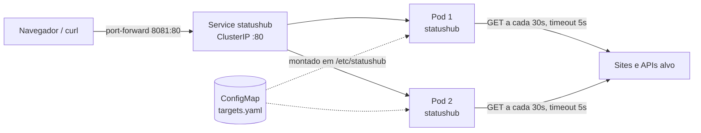

# Arquitetura

## Componentes

| Peça | O que faz |
|---|---|
| `internal/config` | Lê e valida a lista de alvos em YAML (fail fast se estiver inválida) |
| `internal/checker` | Verifica todos os alvos em paralelo (goroutines), com timeout, e guarda o último resultado em memória protegido por `sync.RWMutex` |
| `internal/server` | Rotas HTTP: `/` (página HTML), `/api/status` (JSON), `/healthz` (liveness) e `/readyz` (readiness) |
| `cmd/statushub` | Liga tudo e faz graceful shutdown ao receber SIGTERM |

## Como funciona

- Cada réplica verifica os alvos por conta própria e guarda o último resultado em memória.
- O `/readyz` só responde 200 depois da primeira rodada de verificação; antes disso o Service não manda tráfego para o Pod.
- O `/healthz` nunca depende de nada externo; se ele parar de responder 3 vezes seguidas, o Kubernetes reinicia o container.
- A configuração vem de um ConfigMap montado como arquivo e é lida só na partida.
- Imagem distroless (`static-debian12:nonroot`), rodando como UID 65532, disco somente leitura e sem capabilities.
- Tudo roda num cluster Kind de um nó, dentro do Docker Desktop (WSL2).
